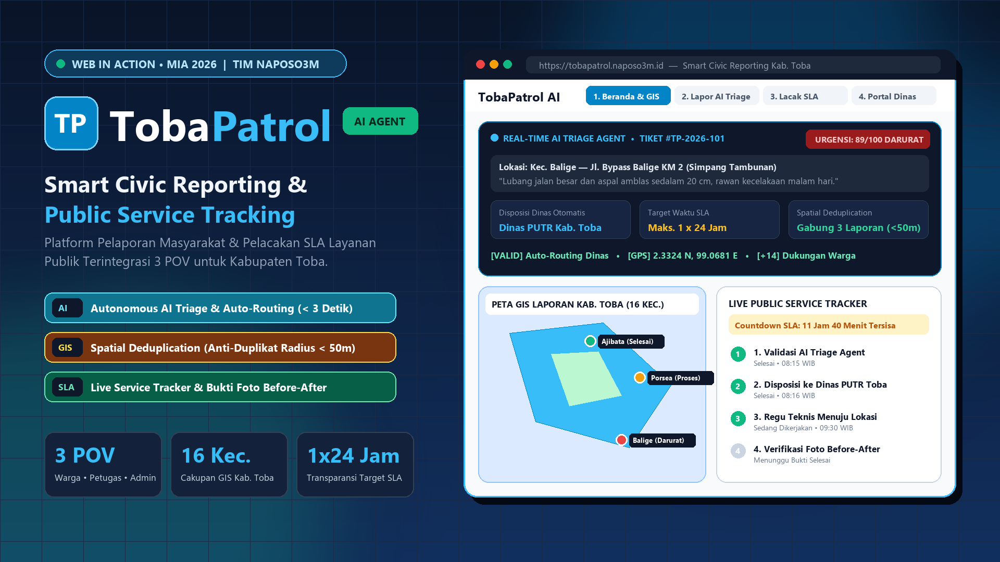

# 🛡️ TobaPatrol — Smart Civic Reporting & Public Service Accountability Platform



> **Diajukan oleh Tim NAPOSO3M** — Kompetisi **Web In Action (WIA) • Multimedia In Action (MIA) 2026**  
> **Tema Utama:** *From Visionaries to Architects of Change*  
> **Subtema:** *Civic Reporting & Accountability* & *Public Service Tracking*

---

## 📌 1. Judul Project & Deskripsi Singkat

**TobaPatrol** adalah platform pelaporan masyarakat (*Civic Reporting & Accountability*) dan pelacakan tindak lanjut layanan publik berbasis **Autonomous Web AI Agent** untuk kawasan Kabupaten Toba (16 Kecamatan). Aplikasi ini menghubungkan **Masyarakat, Admin Dinas, dan Petugas Lapangan** dalam satu ekosistem terpadu untuk mengotomatisasi disposisi instansi, menghitung *Skor Urgensi* keselamatan (1–100), mencegah penumpukan laporan ganda (*Spatial Deduplication* radius < 50m), serta menyediakan pelacakan batas waktu penanganan (*SLA Countdown*) dengan verifikasi bukti foto *Before vs After*.

---

## 🛠️ 2. Tech Stack yang Digunakan

| Kategori | Teknologi | Keterangan Fungsional |
| :--- | :--- | :--- |
| **Frontend & UI** | HTML5, Tailwind CSS, JavaScript (ES6+), Vite | Antarmuka responsif (*Mobile & Desktop*) dengan sistem *12-Column Split Grid*. |
| **Geospatial & Peta GIS** | Leaflet.js & OpenStreetMap | Visualisasi peta interaktif sebaran laporan di 16 kecamatan Kabupaten Toba. |
| **AI Triage Engine** | Autonomous Triage Logic (Gemini API Ready) | Klasifikasi otomatis instansi (PUTR, Dishub, DLH, BPBD), kalkulasi *Urgency Score*, & deteksi duplikasi. |
| **Icons & Typography** | Lucide Icons & Plus Jakarta Sans | Sistem ikon vektor & tipografi modern berketerbacaan tinggi. |
| **Data & State Layer** | Single-Database Realtime State Sync (Supabase Ready) | Sinkronisasi status tiket lintas 3 POV (*Masyarakat, Admin Dinas, Petugas Lapangan*). |

---

## 🚀 3. Cara Menjalankan Project (`Clone` ➔ `Install` ➔ `Run`)

Ikuti langkah-langkah berikut untuk menjalankan project **TobaPatrol** di komputer lokal Anda:

```bash
# 1. Clone repository ini
git clone https://github.com/GraceTiodora/tobapatrol.git
cd tobapatrol

# 2. Install seluruh dependencies
npm install

# 3. Jalankan development server (Vite)
npm run dev
```

* Setelah server berjalan, buka browser (Chrome/Edge/Firefox) dan akses alamat lokal yang muncul di terminal (umumnya `http://localhost:5173`).
* **Alternatif Cepat Tanpa Build:** Anda juga dapat membuka file `index.html` secara langsung di browser atau melalui ekstensi *Live Server* di VS Code.

---

## ✅ 4. Progress Saat Ini (First Draft Submission — 01 November 2026)

Seluruh alur utama **3 POV (Masyarakat, Admin Dinas, Petugas Lapangan)** pada MVP telah selesai dibangun dan berjalan secara interaktif:

1. **Halaman 1 — Beranda & Peta Interaktif Kabupaten Toba (`/#home`):**
   * *Hero Section* dengan pratinjau *Real-Time AI Triage* dan metrik ketuntasan SLA Kabupaten Toba.
   * Ringkasan ekosistem 3 POV (*Masyarakat, Petugas Teknis, Admin Pemda*).
   * **Peta Interaktif GIS (Leaflet.js)** yang menampilkan titik koordinat laporan aktif per kecamatan (*Balige, Ajibata, Porsea, Laguboti*) beserta *popup* navigasi langsung ke tiket.
   * *Live Feed* daftar aduan masyarakat terbaru.
2. **Halaman 2 — Buat Laporan Warga + AI Triage Agent (`/#lapor`):**
   * 4 tombol *Preset Skenario Uji Coba Cepat* kasus nyata di Kabupaten Toba.
   * Formulir pelaporan masyarakat dengan unggah bukti foto ber-*geotag* GPS.
   * **Panel Analisis Real-Time AI Triage Agent** yang langsung menghitung *Skor Urgensi (1–100)*, menentukan *Dinas Tujuan Otomatis*, menetapkan *Target Waktu SLA*, serta mendeteksi laporan ganda dalam radius $< 50\text{ meter}$ (*Spatial Deduplication*).
3. **Halaman 3 — Lacak Tiket & Transparansi SLA (`/#lacak`):**
   * Pencarian Nomor Tiket (`#TP-2026-101`, `#TP-2026-102`, dst.) dan tombol *+1 Upvote Prioritas Warga*.
   * Indikator *Countdown SLA* dan **Timeline Pelacakan 4 Tahap**.
   * Panel perbandingan bukti visual kondisi awal (**Foto Before**) vs kondisi selesai diperbaiki (**Foto After**).
4. **Halaman 4 — Portal Petugas & Admin Dinas (`/#dashboard`):**
   * Banner rekomendasi kebijakan mingguan (*AI Decision Support Insight*) untuk Pemerintah Kabupaten Toba.
   * Tabel antrean disposisi terurut berdasarkan *Skor Urgensi AI* tertinggi, dilengkapi tombol aksi interaktif **"Tugaskan Regu Petugas"** dan **"Upload Bukti & Selesaikan"** yang langsung memperbarui status di halaman publik secara *real-time*.

---

## 📂 Struktur Folder Project

```text
tobapatrol/
├── index.html                          # Entry point & 4 tampilan halaman utama (SPA View)
├── src/
│   └── app.js                          # Logika AI Triage, Leaflet GIS Map, & State Sync 3 POV
├── Thumbnail_TobaPatrol_NAPOSO3M.png   # Banner 16:9 Showcase TobaPatrol
├── package.json                        # Konfigurasi script Vite (dev, build, preview)
└── README.md                           # Dokumentasi utama repository
```

---

## 👥 Tim Pengembang — **NAPOSO3M**
Kompetisi **Web In Action (WIA) — Multimedia In Action (MIA) 2026**  
*Diselenggarakan oleh KSM Multimedia UPN Veteran Jakarta*
